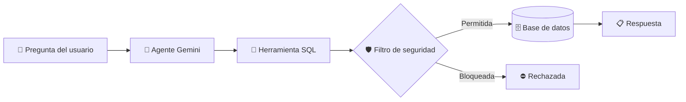

<div align="center">

# 🤖 Agente DBA con Gemini

### Asistente de base de datos que responde en lenguaje natural

Consulta la base de datos de una tienda con preguntas normales, usando **Google Gemini** y una interfaz web en **Streamlit**.

<br>


<br>


</div>

---

## ✨ ¿Qué es?

Un **agente de IA** que actúa como asistente de administración de base de datos (DBA). El usuario escribe una pregunta en español, el agente usa **herramientas** para consultar la base de datos de una tienda y responde con los resultados.

Proyecto de práctica desarrollado en la universidad, bajo la guía de mi profesor.

## 🎯 Características

| | Característica |
|:---:|:---|
| 💬 | **Lenguaje natural**: preguntas normales en lugar de escribir SQL |
| 🧰 | **Agente con herramientas** (`tools.py`) que ejecuta las consultas |
| 🛡️ | **Filtro de seguridad**: revisa las palabras de cada consulta SQL antes de ejecutarla |
| 🌐 | **Interfaz web** con Streamlit (`app.py`) |
| 💻 | **Modo consola** (`main.py`) |
| 🔐 | **Clave de API fuera del código**, mediante variables de entorno |

## 🔄 Flujo



## 🛠️ Tecnologías

| Tecnología | Uso |
|:---|:---|
| Python | Lenguaje principal |
| Streamlit | Interfaz web |
| Google Gemini (`google-genai`) | Modelo de IA |
| SQLite | Base de datos |
| python-dotenv | Variables de entorno |

## 🚀 Cómo ejecutarlo

```bash
# 1. Clonar el repositorio
git clone https://github.com/AreR9/agente-dba-gemini.git
cd agente-dba-gemini

# 2. Instalar dependencias
pip install -r requirements.txt
```

### Configurar la clave de Gemini

Obtén una clave gratuita en [Google AI Studio](https://aistudio.google.com/apikey), copia la plantilla y completa tu clave:

```bash
copy .env.example .env       # Windows
# cp .env.example .env       # Linux / macOS
```

```env
GEMINI_API_KEY=tu_clave_de_google_ai_studio
```

### Ejecutar

```bash
# Interfaz web
streamlit run app.py

# Modo consola
python main.py
```

La interfaz web se abre en **http://localhost:8501**.

> ⚠️ El repositorio **no incluye la base de datos** (`tienda_django.db`). Necesitas una base SQLite con ese nombre en la carpeta del proyecto, o ajustar la ruta en `database.py`.

## 🛡️ Seguridad

- La clave de API **nunca** se escribe en el código: se lee de `GEMINI_API_KEY`.
- El archivo `.env` y la base de datos están excluidos del repositorio (`.gitignore`).
- `tools.py` analiza las palabras de cada consulta SQL antes de ejecutarla.

## 📁 Estructura

```
agente-dba-gemini/
├── 📄 app.py            → interfaz web (Streamlit)
├── 📄 main.py           → modo consola
├── 📄 agent.py          → agente y conexión con Gemini
├── 📄 tools.py          → herramientas y filtro de seguridad
├── 📄 database.py       → conexión a la base de datos
├── 📄 requirements.txt
└── 📄 .env.example      → plantilla de variables de entorno
```

---

<div align="center">

### 👩‍💻 Desarrollado por **Areli Reynoso**

Práctica universitaria realizada con la guía del profesor Erick.

[](https://github.com/AreR9)

</div>
